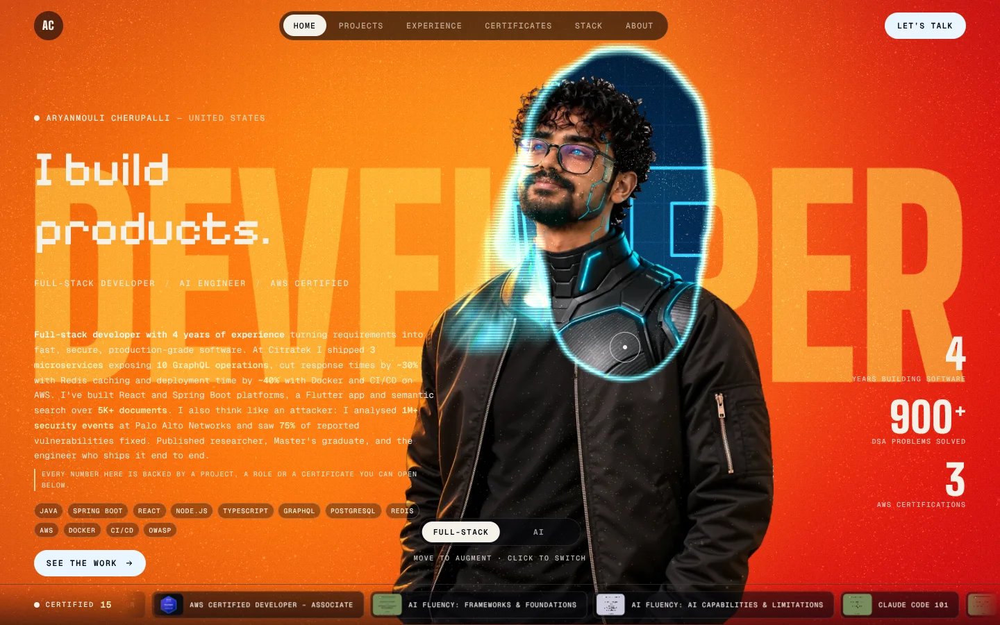
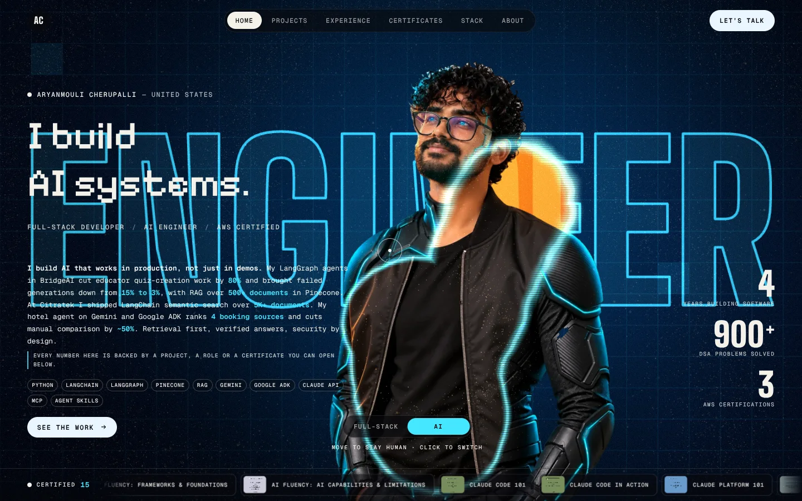
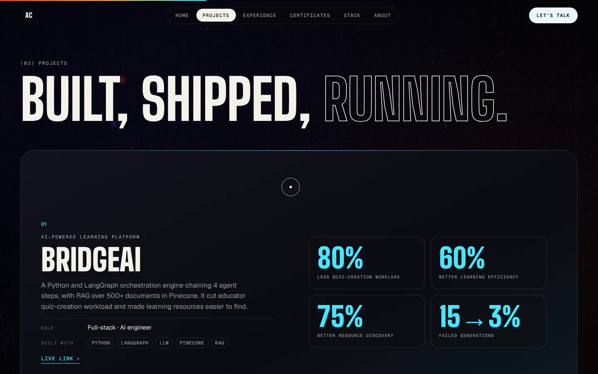
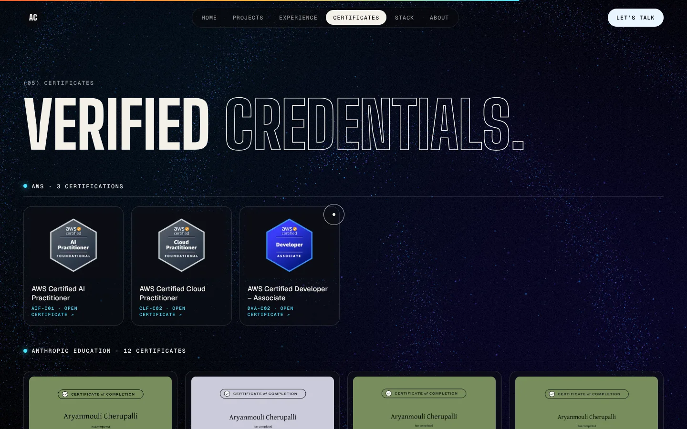
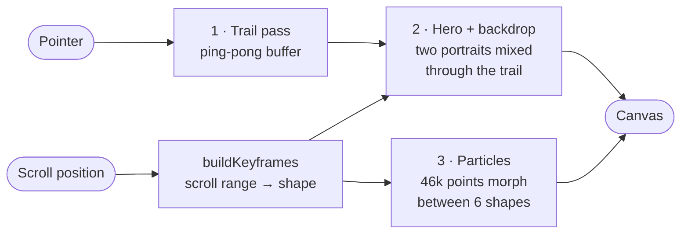
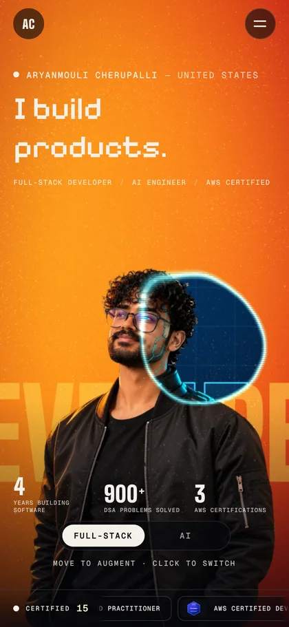

<div align="center">



<br />

# Aryanmouli Cherupalli

### Full-Stack Developer · AI Engineer · AWS Certified

*I build scalable cloud-native applications, LLM and RAG-powered products, and fast, secure digital experiences, and I measure the result.*

<br />

[](https://YOUR-SITE.vercel.app)
[](public/resume.pdf)
[](https://linkedin.com/in/aryanmouli-cherupalli)
[](mailto:aryanmouli.ch@gmail.com)


</div>

---

## ✨ What this is

This repository is the source of my personal portfolio: **one WebGL film that you scroll through**.

It is built around the idea that I have two crafts. The hero holds two pixel-aligned portraits of me, the human one (**Full-Stack**) and an augmented one (**AI**). Your pointer carves a liquid window between them, a click floods the whole scene into the other world, and the headline, copy and colours of the page change with it. Scrolling then dissolves the portrait into **46,000 particles** that re-form into a new 3D shape for every section.

<table>
  <tr>
    <td width="50%"></td>
    <td width="50%"></td>
  </tr>
  <tr>
    <td align="center"><b>I build products.</b><br /><sub>Full-Stack mode · move the pointer to peek at the other self</sub></td>
    <td align="center"><b>I build AI systems.</b><br /><sub>AI mode · click anywhere (or use the switch) to flip the world</sub></td>
  </tr>
</table>

---

## 📊 The numbers behind it

Every figure on the site is tied to a project, a role or a certificate you can open.

| | | | |
|:---:|:---:|:---:|:---:|
| **4**<br /><sub>years building software</sub> | **1,015+**<br /><sub>DSA problems solved</sub> | **15**<br /><sub>certifications<br />3 AWS · 12 Anthropic</sub> | **1M+**<br /><sub>security events analysed</sub> |
| **3**<br /><sub>microservices shipped<br />10 GraphQL operations</sub> | **~30%**<br /><sub>faster API responses<br />(Redis caching)</sub> | **~40%**<br /><sub>faster deployments<br />(Docker + CI/CD)</sub> | **80%**<br /><sub>less educator workload<br />(BridgeAI)</sub> |

---

## 🚀 Selected projects

<div align="center">
  
</div>

<br />

| # | Project | What it is | Built with | Impact |
|:-:|---|---|---|---|
| 01 | **[BridgeAI](https://edu-friened-12.web.app/login)** | AI-powered learning platform. A Python and LangGraph engine chaining 4 agent steps, with RAG over 500+ documents. | Python · LangGraph · LLM · Pinecone · RAG | **80%** less quiz-creation workload · failed generations **15% → 3%** |
| 02 | **Microservices & semantic search** <sub>(Citratek)</sub> | Three Node.js and TypeScript microservices exposing GraphQL, secured with OAuth2 and RBAC, plus AI semantic search over 5K+ documents. | Node.js · GraphQL · Redis · AWS · LangChain | **~30%** faster responses · **~40%** faster deployments |
| 03 | **EduFriend** | Full-stack web and mobile product: React web app, Flask REST APIs on Firebase, Flutter app with a Kotlin module. Infrastructure as code, shipped on ECS and EC2. | React · Flask · Flutter · Firebase · AWS CDK | 12 REST endpoints · 6 mobile screens · 50+ test users |
| 04 | **Smart Hotel Reservation Agent** | Conversational hotel assistant on Gemini and Google ADK that searches, compares and recommends across booking sources. | Python · Streamlit · Gemini · Google ADK | 4 sources ranked · **~50%** less manual comparison |
| 05 | **[Smart Irrigation with LoRa](https://ijisrt.com/smart-irrigation-system-with-lora-recording-of-lora-broadcast-using-rtlsdr-dongle-for-spectrum-analyzation)** | Bachelor's project and **published research paper** (IJISRT). Soil sensors talk over LoRa to a Raspberry Pi gateway, with an SMS two-factor web app to control the water motors. | LoRa SX1278 · Raspberry Pi · NodeMCU · RTL-SDR | [Paper PDF](public/papers/smart-irrigation-lora-paper.pdf) |
| 06 | **Solar Light Design for Night Time** | Solar-powered street light with PIR motion sensing that switches an LED bank between bright and dim. | Solar PV · PIR · MOSFET · LiFePO4 | [Project report](public/papers/solar-light-project-report.pdf) |

---

## 💼 Experience

```text
2025 ─────────────────────────────────────────────────────────────── now
  ●  Full-Stack Developer · Citratek Inc.            Jun 2025 – Present · Tampa, Florida
  ●  Master's, Information Systems Technologies      2023 – 2025 · Wilmington University (3.8)

2021 ─────────────────────────────────────────────────────────────── 2023
  ●  Junior Software Developer · Corematiq Inc.      Jan 2021 – Feb 2023 · Hyderabad, India
  ●  Cybersecurity Analyst Intern · Palo Alto Networks   Oct 2021 – Dec 2021
  ●  Bachelor's, Electronics & Communication · VBIT  Hyderabad, India (3.75)
```

<details>
<summary><b>Citratek Inc. · Full-Stack Developer</b> (what I shipped)</summary>

- Built and maintained **3 Node.js and TypeScript microservices** exposing **10 GraphQL queries and mutations**, with OAuth2, RBAC and secure coding aligned to the OWASP Top 10.
- Added **Redis caching** and tuned MongoDB and DynamoDB data access, cutting average response time by **~30%**.
- Deployed on AWS (Lambda, S3, API Gateway, SQS) with Docker, GitHub Actions and CI/CD, cutting deployment time by **~40%**.
- Built an **AI semantic search** feature with Python, RAG, LangChain and Pinecone over **5K+ documents**.
- Wrote integration tests with Jest (about 60% coverage) and tracked sprint work in Jira.
</details>

<details>
<summary><b>Corematiq Inc. · Junior Software Developer</b></summary>

- Developed and maintained **4 web application modules** with Java, Spring Boot, JavaScript, HTML5 and CSS3.
- Built and integrated **6 REST APIs** with Spring Boot, connected to React.js components and tested with Postman.
- Optimised SQL queries and supported schema design for 3 PostgreSQL tables, improving data retrieval time by about **20%**.
- Implemented **JWT authentication** across 2 internal web applications; fixed 20+ bugs in Agile sprints.
</details>

<details>
<summary><b>Palo Alto Networks · Cybersecurity Analyst Intern</b></summary>

- Ran vulnerability assessments and penetration tests with Metasploit on **5 applications and network systems**.
- Monitored and analysed **1M+ security events** with Wireshark and system logs; escalated 35% as confirmed incidents.
- Recommended secure coding fixes for 8 issues, with **75%** of reported vulnerabilities remediated by the end of the internship.
</details>

---

## 🧰 Tech stack

<div align="center">


<br />


</div>

| Area | What I work with |
|---|---|
| **Languages** | Java · Python · TypeScript · JavaScript (ES6+) · C · C++ · C# · Dart · Kotlin · Objective-C |
| **Frontend & mobile** | React.js · HTML5 · CSS3 · Responsive design · Flutter |
| **Backend** | Spring Boot · Node.js · REST APIs · GraphQL · Microservices · Flask |
| **AI / LLM** | LangChain · LangGraph · RAG · Pinecone · Semantic search · Gemini · Google ADK · Claude API · MCP · Agent Skills |
| **Databases** | PostgreSQL · SQL · MongoDB · DynamoDB · Firebase · Redis |
| **Cloud & DevOps** | AWS (EC2, S3, Lambda, ECS, SQS, API Gateway) · CDK · CloudFormation · Docker · Kubernetes · CI/CD · GitHub Actions |
| **Security** | JWT · OAuth2 · RBAC · OWASP Top 10 · HTTPS · CORS · Secure coding · Metasploit · Wireshark |
| **Testing & process** | JUnit · Jest · Unit and integration testing · Postman · Git · Jira · Agile / Scrum · Code reviews |

---

## 🏅 Certifications

<div align="center">
  
</div>

<br />

**AWS · 3 certifications**

| Certification | Exam | Certificate |
|---|:-:|:-:|
| AWS Certified AI Practitioner | AIF-C01 | [PDF](public/certificates/aws/ai-practitioner.pdf) |
| AWS Certified Cloud Practitioner | CLF-C02 | [PDF](public/certificates/aws/cloud-practitioner.pdf) |
| AWS Certified Developer – Associate | DVA-C02 | [PDF](public/certificates/aws/developer-associate.pdf) |

**Anthropic Education · 12 certificates**

[AI Fluency: Frameworks & Foundations](public/certificates/anthropic/ai-fluency-frameworks.pdf) ·
[AI Fluency: AI Capabilities & Limitations](public/certificates/anthropic/ai-fluency-capabilities.pdf) ·
[Claude Code 101](public/certificates/anthropic/claude-code-101.pdf) ·
[Claude Code in Action](public/certificates/anthropic/claude-code-in-action.pdf) ·
[Claude Platform 101](public/certificates/anthropic/claude-platform-101.pdf) ·
[Claude with Google Vertex AI](public/certificates/anthropic/claude-vertex-ai.pdf) ·
[Claude with the Anthropic API](public/certificates/anthropic/claude-api.pdf) ·
[Introduction to Agent Skills](public/certificates/anthropic/agent-skills.pdf) ·
[Introduction to Claude Cowork](public/certificates/anthropic/claude-cowork.pdf) ·
[Introduction to Model Context Protocol](public/certificates/anthropic/mcp-intro.pdf) ·
[Model Context Protocol: Advanced Topics](public/certificates/anthropic/mcp-advanced.pdf) ·
[Introduction to Subagents](public/certificates/anthropic/subagents.pdf)

---

## 🎬 How the site is built

One page, **one WebGL renderer**, no framework. Everything else is ordinary DOM animated with GSAP.



| Pass | What it does |
|---|---|
| **1 · Pointer trail** | A low-resolution render target that blurs, drifts and decays each frame while the pointer's path is stamped into it. It becomes the "how augmented is this pixel" mask. |
| **2 · Hero and backdrop** | A fragment shader that mixes the human and AI portraits through the trail mask, adds the giant word behind the shoulders, and fades into the dark site backdrop on scroll. |
| **3 · Particles** | 46,000 points (20,000 on phones) that blend between six targets (nebula, interface panels, agent, pipeline, bust, globe) with turbulence that peaks mid-morph and a pointer repel force. |

**Highlights**

- 🧑‍🤝‍🧑 **Two faces, one pose.** Both portraits are pixel-aligned, so the reveal feels like a second self under the surface, not a fade.
- 🌌 **Particles that arrive, not snap.** Scroll ranges map to shapes, positions and colours, so each section has its own form.
- 📌 **Pinned craft chapters** (Full-Stack, AI and LLM, Cloud and Security) with a clip-path image reveal.
- 🃏 **Stacked project deck**, a rotating 3D **logo ring** and a looping certificate ribbon in the hero.
- 📱 **Responsive down to phones**: hamburger menu, lighter particle count and a dedicated intro block.
- ♿ **Accessible**: skip link, real links and buttons, `prefers-reduced-motion` support, and a still-gradient fallback when WebGL is unavailable.
- ⚡ **Performance**: a single canvas, capped pixel ratio, lazy-loaded images, and a lighter particle count on phones.

<div align="center">
  
  <br /><sub>Phone layout</sub>
</div>

### Built with


---

## 📁 Project structure

```text
.
├── index.html                 # all static copy and page structure
├── src/
│   ├── main.js                # boot, loader, smooth scroll, GSAP animation, particle keyframes
│   ├── content.js             # copy rendered from JS: hero modes, craft chapters, stack lists
│   ├── style.css              # the whole stylesheet
│   ├── gl/
│   │   ├── stage.js           # the single WebGL stage (three passes a frame)
│   │   ├── shaders.js         # GLSL for the trail, hero and particles
│   │   └── shapes.js          # particle targets: nebula, panels, agent, pipeline, bust, globe
│   └── icons/                 # brand marks for the logo ring
├── public/
│   ├── assets/                # portraits, role images, video, point clouds, logos, screenshots
│   ├── certificates/          # AWS and Anthropic certificates (PDF + WebP preview)
│   ├── papers/                # research paper and project report
│   └── resume.pdf
├── scripts/                   # image, point-cloud and screenshot tooling
└── docs/screenshots/          # images used in this README
```

---

## ⚙️ Run it locally

**Requirements:** [Node.js 20+](https://nodejs.org/)

```bash
# 1. Clone
git clone https://github.com/Aryanch1/Aryanmouli-Cherupalli-Portfolio.git
cd Aryanmouli-Cherupalli-Portfolio

# 2. Install
npm install

# 3. Start the dev server → http://localhost:5173
npm run dev
```

| Command | What it does |
|---|---|
| `npm run dev` | Start the Vite dev server |
| `npm run build` | Create the production build in `dist/` |
| `npm run preview` | Serve the production build locally |

> 💡 Add `?debug` to the URL to expose `window.__stage` and `window.__ScrollTrigger` in the browser console.

### Deploy

The build uses a **relative base** (`base: './'`), so the static `dist/` folder works from any host or sub-path.

- **Vercel:** import the repo, framework preset **Vite**, build command `npm run build`, output directory `dist`. Every push to `main` redeploys.
- **GitHub Pages / Netlify / Cloudflare Pages:** run `npm run build` and publish `dist/`.

### Make it yours

- Copy, links and skills live in [`src/content.js`](src/content.js) and [`index.html`](index.html).
- Colours and type are the CSS variables at the top of [`src/style.css`](src/style.css).
- Particle behaviour per section is the `buildKeyframes()` table in [`src/main.js`](src/main.js).
- The helper scripts in [`scripts/`](scripts) rebuild the portrait WebPs and the sampled point clouds from your own images and 3D meshes.

---

## 📬 Let's connect

I'm open to full-stack and AI engineering roles, and to interesting products to build.

| | |
|---|---|
| 📧 **Email** | [aryanmouli.ch@gmail.com](mailto:aryanmouli.ch@gmail.com) |
| 💼 **LinkedIn** | [in/aryanmouli-cherupalli](https://linkedin.com/in/aryanmouli-cherupalli) |
| 🐙 **GitHub** | [@Aryanch1](https://github.com/Aryanch1) |
| 🧩 **LeetCode** | [u/Aryanmouli](https://leetcode.com/u/Aryanmouli) |
| 📚 **GeeksforGeeks** | [@aryanmov1z0](https://www.geeksforgeeks.org/profile/aryanmov1z0?tab=activity) |
| 📄 **Resume** | [Download PDF](public/resume.pdf) |

---

<div align="center">

**Full-stack by trade. AI builder by curiosity. Security-minded by training.**

<sub>© 2026 Aryanmouli Cherupalli. The portraits, resume, certificates and written content are mine and are not licensed for reuse.<br />
The WebGL portfolio structure started from the "Augmented" portfolio template by Brand Motion Studios.</sub>

</div>
